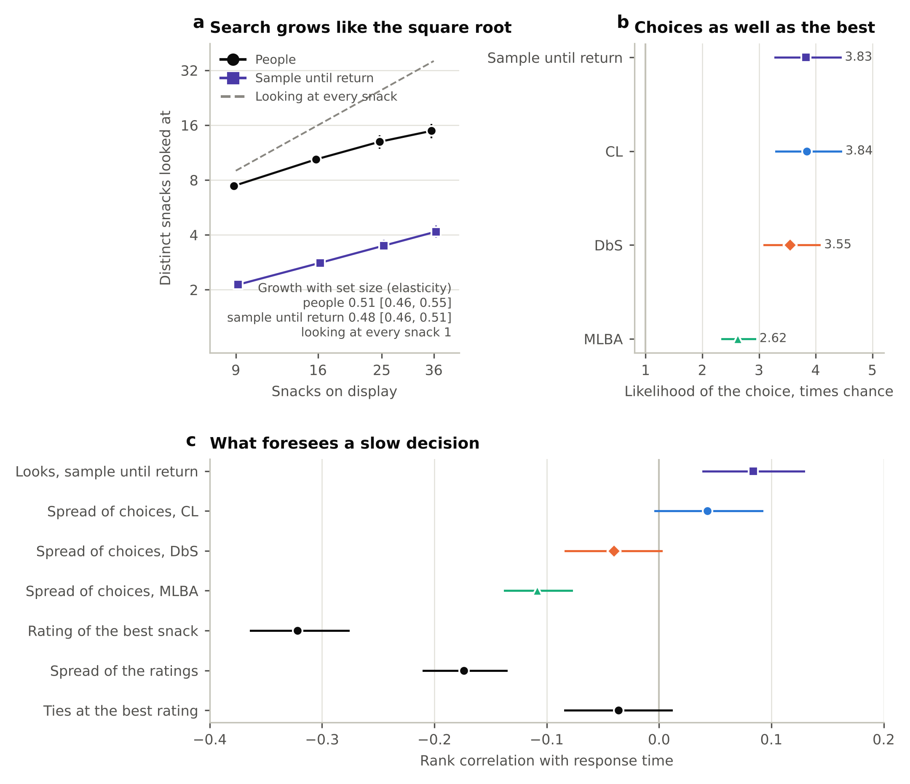
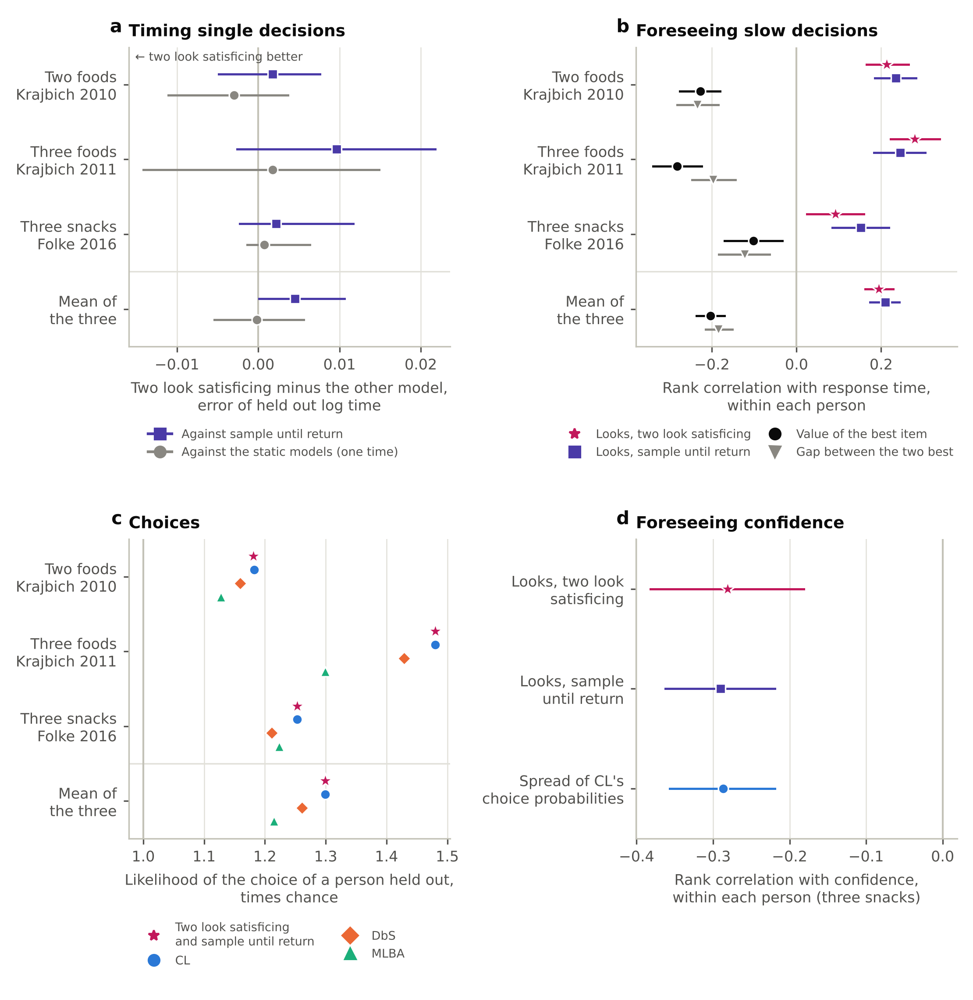

# overload-prediction

[](https://github.com/ucchol/overload-prediction/actions/workflows/ci.yml)

Preregistered tests of how people choose when choice sets grow, built on held out prediction with one parameter choice models.

Does a larger set make choices noisier, or do people narrow their search and choose more selectively? Each choice model here states a mechanism, has a single free parameter and is judged by how well it predicts choices it was not fitted to. Every hypothesis, model, measure and decision rule is fixed in a written plan before its test runs, and every reported number is computed twice by this package and once more by an independent implementation.

## Status, October 2026

| Hypothesis | Development data (file selection, laptop purchase) | Confirmatory data (open snack choices and open gaze data) |
|---|---|---|
| H1 Narrowing with set size | Choices were more concentrated than the models predicted in both tasks. For laptops the gap grew with set size, noise was rejected and sensitivity rose with set size. Files show the concentration only | Noise rejected. Sensitivity to liking rose with set size while attention narrowed |
| H2 Comparison under sparse information | Known for laptops, not for files | Open dataset being chosen |
| H3 Inputs over rules | To run | |
| H4 Cost depends on cue validity | To specify | |
| Overload, time and search (research program) | Overload rose with set size for files and never appeared for laptops. No model's work explained how long people took. The search model, sample until return, matched the best models on choices | Search grew like the square root of the set size, as the search model predicted, though people looked at 3.6 times as many items. Its choices were as accurate as CL's and its expected looks foresaw slow decisions, but it did not time single decisions better (Amendment 5). An absolute standard (two look satisficing), built on the snack data, was frozen and tested on three gaze datasets (Amendment 6). It did no better than sample until return on time or slow decisions, while its choices, those of sample until return, matched CL and beat DbS and MLBA |

Laptop trials 5 and 6 were corrected from the study's storyboard on 10 October 2026 (plan, Amendment 4), and every laptop result was rerun and verified again. The full record is in [`STORY.md`](STORY.md), and the program of the next analyses (overload, decision time and a search model) in [`RESEARCH_PROGRAM.md`](RESEARCH_PROGRAM.md).



Confirmatory test of the search model, sample until return, on the snack data (plan, Amendment 5). (a) The number of snacks people looked at grew like the square root of the number shown, as the model predicted, though at a higher level. (b) Unseen choices were predicted as well as by CL. (c) Within a person, slow decisions were foreseen by the model's expected looks, and far better by a low rating of the best snack. Bars are 95 percent intervals from 1000 participant resamples.



Confirmatory test of two look satisficing on three open gaze datasets of choices between two or three foods (plan, Amendment 6). (a) It did not time single decisions of people held out better than sample until return or than one constant time. (b) Within each person, its expected looks foresaw slow decisions no better than sample until return's, and about as well as the value of the best item. (c) Choices of people held out, as accurate as CL and, over the three datasets taken together, better than DbS and MLBA. (d) In Folke's snacks, more expected looks went with lower confidence for both search models. Bars are 95 percent intervals from 1000 participant resamples.


Confirmatory test of H1 on the data of Thomas, Molter and Krajbich (2021). (a) Participants looked at a shrinking share of the display as it grew. (b) Their sensitivity to liking rose with set size, over all items and over the items they looked at. (c) Letting sensitivity fall with set size, as the noise account does, predicted unseen set sizes worst. Bars are 95 percent intervals from 1000 participant resamples.

## How the work is organized

- [`ANALYSIS_PLAN.md`](ANALYSIS_PLAN.md) fixes the question, hypotheses, models, measures, folds, resampling and decision rules. Amendments are appended with a date and a reason, earlier text is never edited, and the SHA-256 digest of every version is logged.
- [`STORY.md`](STORY.md) records the story, the status of every hypothesis and every result with the plan version it was produced under.
- [`RESEARCH_PROGRAM.md`](RESEARCH_PROGRAM.md) maps the analyses still to come, each with its question, method and the message it is meant to deliver.
- [`verification/`](verification) holds the independent implementations, written from the plan and a brief without access to this package, their results and the scripts that compare them with the package.
- [`results/`](results) holds one folder per result with its summary, tables and figures.
- [`notebooks/01_baseline_and_h1.ipynb`](notebooks/01_baseline_and_h1.ipynb) and [`notebooks/02_overload_time_search.ipynb`](notebooks/02_overload_time_search.ipynb) walk through every result in writing, code and findings cells and run in Google Colab.

```
src/overload/
  coding.py         attribute coding of the development study's options
  data.py           tasks, trials, rubric shares and the choice panel
  snack.py          the open snack choice data, models and fits for displays seen once
  models.py         QR, CL, DbS, MLBA, set size scaling, elimination by aspects, search models
  search.py         sample until return and accept in reading order, choice probabilities and search length
  snack_search.py   sample until return on the snack data, by rating level
  effort.py         elementary steps each model needs on a display
  responses.py      post-trial answers, regret and decision time, with the overload index
  fit.py            one parameter maximum likelihood, fitted, held out and alone predictions
  metrics.py        log score, attainable score, completeness, overlap, effective number
  bootstrap.py      participant resampling, intervals, Holm correction
  engine.py         one bootstrap replicate of an experiment, provenance
  figures.py        figures of the results
  experiments/      one module per result of the plan
  stimuli/          option definitions and rubric scores of the development study
tests/              unit tests, reproduction tests and end to end runs on synthetic data
scripts/            download of the open confirmatory data at a pinned commit, design check of test S5
```

## Models

Each model scores the options of a display and turns the scores into choice probabilities with one fitted sensitivity. Elimination by aspects fits a lapse toward a uniform guess instead.

| Model | Score of an option |
|---|---|
| QR, quantal response | the designers' rubric score |
| CL, conditional logit | rubric weighted sum of its attribute levels |
| DbS, decision by sampling | rubric weighted count of the rivals it beats on each attribute, summed or averaged over rivals |
| MLBA, multiattribute linear ballistic accumulator | rubric weighted, distance weighted comparisons with every rival, summed or averaged over rivals |
| EBA, elimination by aspects | probability of surviving elimination on the rubric's attributes |
| SR, sample until return (proposed) | attention lands on options with probability softmax(lambda v), and the first option looked at twice is chosen, so the values of CL (or of DbS and MLBA) give choices, expected looks and time |
| TLS, two look satisficing (extension, rejected on new data) | as SR, but a look registers with a probability that rises with the option's value against the top of the scale, and the first option registered twice is chosen. Same choices as SR, with time that depends on absolute value |

Set size scaling multiplies the scores by ((n - 1) / 7)^beta. Negative beta makes choices noisier as sets grow and positive beta makes them sharper.

## Measures

- Completeness, the share of the attainable held out log score a model reaches. Zero is a uniform guess and about 100 is the true choice probabilities.
- Overlap, the share of choices on which predicted and observed distributions agree.
- For data in which every display is new, the held out likelihood of the chosen option relative to a uniform guess.

## Quick start

```bash
git clone https://github.com/ucchol/overload-prediction.git
cd overload-prediction
pip install -e ".[dev]"
pytest
```

Python 3.10 or later. Tests that need the development data skip without it. The library versions behind the reported results are listed in `requirements-lock.txt`.

## Reproducing the results

```bash
export OVERLOAD_DATA=/path/to/Updated_Choice_Overload.csv
python -m overload.experiments.baseline --data $OVERLOAD_DATA --out results/baseline --jobs 2
python -m overload.experiments.h1_narrowing --data $OVERLOAD_DATA --out results/h1 --jobs 2
python -m overload.experiments.overload_index --data $OVERLOAD_DATA --out results/overload
python -m overload.experiments.process_dev --data $OVERLOAD_DATA --out results/process_dev --jobs 2
sh scripts/fetch_snack_data.sh data/snack
python -m overload.experiments.h1_confirmatory --snack data/snack --out results/h1_confirmatory --jobs 2
python -m overload.experiments.search_confirmatory --snack data/snack --out results/search_confirmatory --jobs 2
python -m overload.experiments.two_look_snack --snack data/snack --out results/two_look_snack --jobs 2
sh scripts/fetch_gaze_data.sh data/gaze
python -m overload.experiments.two_look_gaze --gaze data/gaze --out results/two_look_gaze --jobs 2
sh scripts/prepare_cdm_data.sh PATH_TO/116100-V1.zip data/cdm   # a manual download, see data/README.md
python -m overload.experiments.stopping_cdm --cdm data/cdm --out results/stopping_cdm --jobs 2
```

Every experiment draws 1000 participant resamples with fixed seeds, so a rerun reproduces the saved files exactly. With two processes the baseline takes about 1 minute, H1 about 3, the overload index a few seconds, the process analyses about 15 minutes, the confirmatory H1 test about 13, the confirmatory search tests about 12 and the gaze test about 15.

The independent checks rerun with

```bash
sh verification/run_independent.sh $OVERLOAD_DATA
sh verification/run_independent_process.sh $OVERLOAD_DATA
sh verification/run_independent_snack.sh
sh verification/run_independent_search.sh
sh verification/run_independent_two_look.sh
sh verification/run_independent_gaze.sh
sh verification/run_independent_cdm.sh
```

## Data

Participant data are never committed. The development data, from a study of file selection and laptop purchase choices, are read from a path you give. The confirmatory snack and gaze data are open under the MIT license and are fetched at pinned commits. The search and satisficing data are open under CC BY 4.0 and need a free openICPSR sign in, so they are downloaded by hand and checked against a pinned hash. See [`data/README.md`](data/README.md).

No output of this repository reports participant counts. Shares are given as percentages.

## Credits

The confirmatory data come from Thomas, A. W., Molter, F., and Krajbich, I. (2021). Uncovering the computational mechanisms underlying many-alternative choice. eLife, 10, e57012. Data and code at [athms/many-item-choice](https://github.com/athms/many-item-choice).

The gaze data come from Thomas, A. W., Molter, F., Krajbich, I., Heekeren, H. R., and Mohr, P. N. C. (2019). Gaze bias differences capture individual choice behaviour. Nature Human Behaviour, 3, 625 to 635, data and code at [athms/gaze-bias-differences](https://github.com/athms/gaze-bias-differences), who prepared the data of Krajbich, Armel and Rangel (2010, Nature Neuroscience), Krajbich and Rangel (2011, PNAS) and Folke, Jacobsen, Fleming and De Martino (2016, Nature Human Behaviour).

The search and satisficing data come from Caplin, A., Dean, M., and Martin, D. (2011). Search and satisficing. American Economic Review, 101(7), 2899 to 2922, replication package at [openICPSR project 116100](https://www.openicpsr.org/openicpsr/project/116100/version/V1/view) (CC BY 4.0).

Code under the MIT license (`LICENSE`). Maintained by Asif Rahman, University of Texas at El Paso ([ucchol.github.io](https://ucchol.github.io)).
