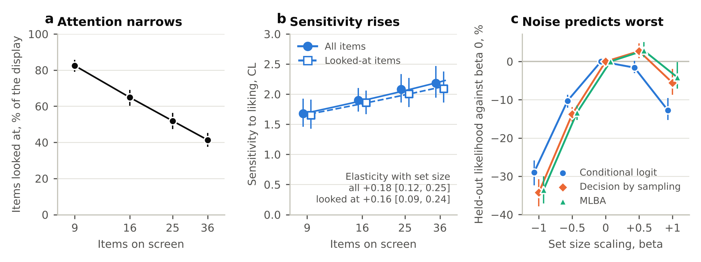

# overload-prediction

[](https://github.com/ucchol/overload-prediction/actions/workflows/ci.yml)

Preregistered tests of how people choose when choice sets grow, built on held out prediction with one parameter choice models.

Does a larger set make choices noisier, or do people narrow their search and choose more selectively? Each choice model here states a mechanism, has a single free parameter and is judged by how well it predicts choices it was not fitted to. Every hypothesis, model, measure and decision rule is fixed in a written plan before its test runs, and every reported number is computed twice by this package and once more by an independent implementation.

## Status, October 2026

| Hypothesis | Development data (file selection, laptop purchase) | Confirmatory data (open snack choices) |
|---|---|---|
| H1 Narrowing with set size | Choices were more concentrated than the models predicted, increasingly so with set size for laptops. Noise rejected for laptops | Noise rejected. Sensitivity to liking rose with set size while attention narrowed |
| H2 Comparison under sparse information | Known for laptops, not for files | Open dataset being chosen |
| H3 Inputs over rules | To run | |
| H4 Cost depends on cue validity | To specify | |

Laptop results are provisional while the laptop displays are checked against the survey export. The full record is in [`STORY.md`](STORY.md).



Confirmatory test of H1 on the data of Thomas, Molter and Krajbich (2021). (a) Participants looked at a shrinking share of the display as it grew. (b) Their sensitivity to liking rose with set size, over all items and over the items they looked at. (c) Letting sensitivity fall with set size, as the noise account does, predicted unseen set sizes worst. Bars are 95 percent intervals from 1000 participant resamples.

## How the work is organized

- [`ANALYSIS_PLAN.md`](ANALYSIS_PLAN.md) fixes the question, hypotheses, models, measures, folds, resampling and decision rules. Amendments are appended with a date and a reason, earlier text is never edited, and the SHA-256 digest of every version is logged.
- [`STORY.md`](STORY.md) records the story, the status of every hypothesis and every result with the plan version it was produced under.
- [`verification/`](verification) holds the independent implementations, written from the plan and a brief without access to this package, their results and the scripts that compare them with the package.
- [`results/`](results) holds one folder per result with its summary, tables and figures.
- [`notebooks/01_baseline_and_h1.ipynb`](notebooks/01_baseline_and_h1.ipynb) walks through every result in writing, code and findings cells and runs in Google Colab.

```
src/overload/
  coding.py         attribute coding of the development study's options
  data.py           tasks, trials, rubric shares and the choice panel
  snack.py          the open snack choice data, models and fits for displays seen once
  models.py         QR, CL, DbS, MLBA, set size scaling, elimination by aspects
  fit.py            one parameter maximum likelihood, fitted, held out and alone predictions
  metrics.py        log score, attainable score, completeness, overlap, effective number
  bootstrap.py      participant resampling, intervals, Holm correction
  engine.py         one bootstrap replicate of an experiment, provenance
  figures.py        figures of the results
  experiments/      one module per result of the plan
  stimuli/          option definitions and rubric scores of the development study
tests/              unit tests, reproduction tests and end to end runs on synthetic data
scripts/            download of the open confirmatory data at a pinned commit
```

## Models

Each model scores the options of a display and turns the scores into choice probabilities with one fitted sensitivity. Elimination by aspects fits a lapse toward a uniform guess instead.

| Model | Score of an option |
|---|---|
| QR, quantal response | the designers' rubric score |
| CL, conditional logit | rubric weighted sum of its attribute levels |
| DbS, decision by sampling | rubric weighted count of the rivals it beats on each attribute, summed or averaged over rivals |
| MLBA, multiattribute linear ballistic accumulator | rubric weighted, distance weighted comparisons with every rival, summed or averaged over rivals |
| EBA, elimination by aspects | probability of surviving elimination on the rubric's attributes |

Set size scaling multiplies the scores by ((n - 1) / 7)^beta. Negative beta makes choices noisier as sets grow and positive beta makes them sharper.

## Measures

- Completeness, the share of the attainable held out log score a model reaches. Zero is a uniform guess and about 100 is the true choice probabilities.
- Overlap, the share of choices on which predicted and observed distributions agree.
- For data in which every display is new, the held out likelihood of the chosen option relative to a uniform guess.

## Quick start

```bash
git clone https://github.com/ucchol/overload-prediction.git
cd overload-prediction
pip install -e ".[dev]"
pytest
```

Python 3.10 or later. Tests that need the development data skip without it. The library versions behind the reported results are listed in `requirements-lock.txt`.

## Reproducing the results

```bash
export OVERLOAD_DATA=/path/to/Updated_Choice_Overload.csv
python -m overload.experiments.baseline --data $OVERLOAD_DATA --out results/baseline --jobs 2
python -m overload.experiments.h1_narrowing --data $OVERLOAD_DATA --out results/h1 --jobs 2
python -m overload.experiments.sens_laptop_rubric --data $OVERLOAD_DATA --out results/exploratory/laptop_rubric_1to4 --jobs 2
sh scripts/fetch_snack_data.sh data/snack
python -m overload.experiments.h1_confirmatory --snack data/snack --out results/h1_confirmatory --jobs 2
```

Every experiment draws 1000 participant resamples with fixed seeds, so a rerun reproduces the saved files exactly. With two processes the baseline takes about 2 minutes, H1 about 5, the laptop check about 7 and the confirmatory test about 13.

The independent checks rerun with

```bash
sh verification/run_independent.sh $OVERLOAD_DATA
sh verification/run_independent_snack.sh
```

## Data

Participant data are never committed. The development data, from a study of file selection and laptop purchase choices, are read from a path you give. The confirmatory snack data are open under the MIT license and are fetched at a pinned commit. See [`data/README.md`](data/README.md).

No output of this repository reports participant counts. Shares are given as percentages.

## Credits

The confirmatory data come from Thomas, A. W., Molter, F., and Krajbich, I. (2021). Uncovering the computational mechanisms underlying many-alternative choice. eLife, 10, e57012. Data and code at [athms/many-item-choice](https://github.com/athms/many-item-choice).

Code under the MIT license (`LICENSE`). Maintained by Asif Rahman, University of Texas at El Paso ([ucchol.github.io](https://ucchol.github.io)).
